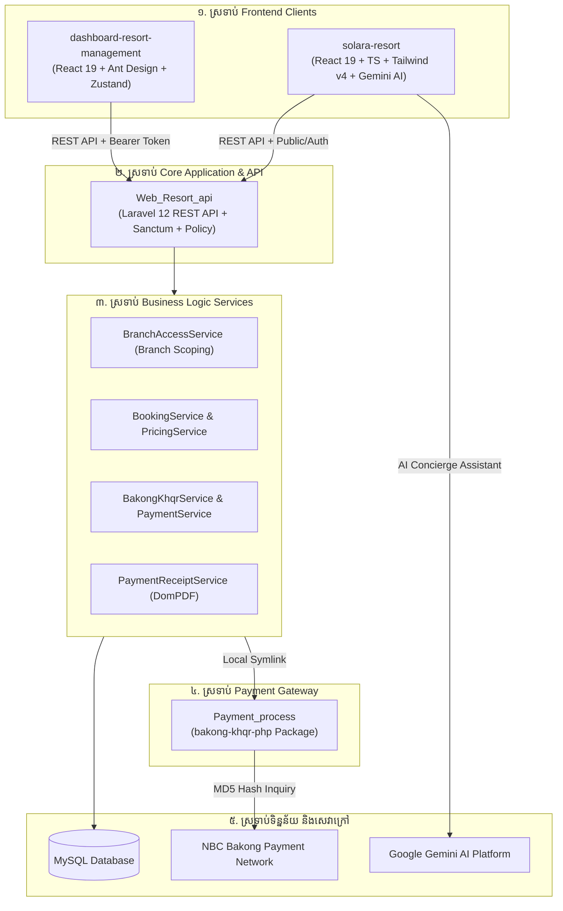
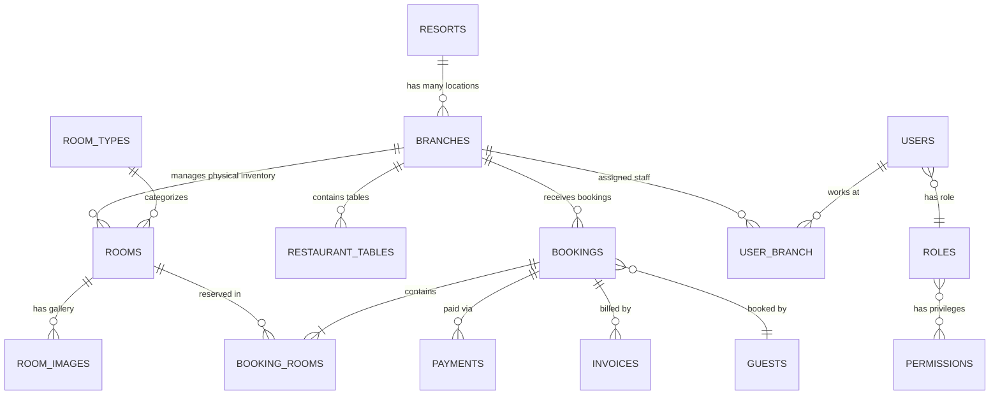
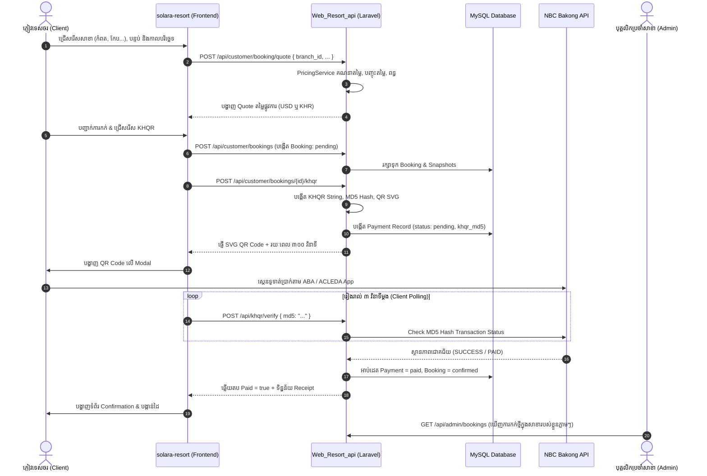

# ឯកសារវិភាគស្ថាបត្យកម្ម និងបច្ចេកទេសប្រព័ន្ធគ្រប់គ្រងរមណីយដ្ឋាន Solara
## (Solara Multi-Branch Resort Management & Customer Booking Ecosystem)

**តួនាទី៖** Senior Full-Stack Software Architect / Lead Developer  
**កាលបរិច្ឆេទវិភាគ៖** ខែ តុលា ឆ្នាំ ២០២៦  
**ឈ្មោះគម្រោង៖** Solara Resort Management System  
**Repository:** `Admin-dashboard-controller`  
**គំរូអាជីវកម្ម៖** ម៉ាកយីហោរមណីយដ្ឋានតែមួយ មានច្រើនសាខា (Single Brand, Multi-Branch)  
**ភាសា និងរូបិយប័ណ្ណ៖** Global Khmer & English / Dual Currency (USD $ & KHR ៛)

---

## មាតិកា (Table of Contents)
1. [សេចក្តីផ្តើម និងចក្ខុវិស័យនៃប្រព័ន្ធ (System Vision & Single Brand Multi-Branch Concept)](#១-សេចក្តីផ្តើម-និងចក្ខុវិស័យនៃប្រព័ន្ធ)
2. [ស្ថាបត្យកម្ម Monorepo ទាំង ៤ ស្រទាប់ (High-Level Architecture)](#២-ស្ថាបត្យកម្ម-monorepo-ទាំង-៤-ស្រទាប់)
3. [ការវិភាគបច្ចេកវិទ្យាលម្អិត (Technology Stack Breakdown)](#៣-ការវិភាគបច្ចេកវិទ្យាលម្អិត)
4. [រចនាសម្ព័ន្ធទិន្នន័យ និងទំនាក់ទំនង (Database Schema & Entity Relationships)](#៤-រចនាសម្ព័ន្ធទិន្នន័យ-និងទំនាក់ទំនង)
5. [ការវិភាគម៉ូឌុលមុខងារស្នូលទាំង ៨ (Core Functional Modules Breakdown)](#៥-ការវិភាគម៉ូឌុលមុខងារស្នូលទាំង-៨)
6. [វដ្តប្រតិបត្តិការអាជីវកម្ម និងលំហូរទិន្នន័យ (Business Workflows & Sequence Diagrams)](#៦-វដ្តប្រតិបត្តិការអាជីវកម្ម-និងលំហូរទិន្នន័យ)
7. [ការវាយតម្លៃផ្នែកសន្តិសុខ និងសុក្រឹតភាពទិន្នន័យ (Security & Data Integrity)](#៧-ការវាយតម្លៃផ្នែកសន្តិសុខ-និងសុក្រឹតភាពទិន្នន័យ)
8. [ផែនទីបង្ហាញផ្លូវសម្រាប់ Production (Production-Ready Roadmap)](#៨-ផែនទីបង្ហាញផ្លូវសម្រាប់-production)

---

## ១. សេចក្តីផ្តើម និងចក្ខុវិស័យនៃប្រព័ន្ធ

ប្រព័ន្ធ **Solara Resort Management System** ត្រូវបានរចនាឡើងយ៉ាងពិសេសសម្រាប់ដំណើរការអាជីវកម្មបែប **Single Brand Resort with Multiple Branches** (ម៉ាកយីហោរមណីយដ្ឋានតែមួយ ប៉ុន្តែមានច្រើនសាខា ដូចជា **Solara Resort សាខាកំពត, សាខាកែប, សាខាសៀមរាប, និងសាខាកោះរ៉ុង**):

1. **ផ្នែកអតិថិជន (B2C Guest Booking Portal):** ភ្ញៀវចូលមកគេហទំព័រតែមួយ ស្វែងរកទីតាំង/សាខាដែលខ្លួនចង់ទៅកម្សាន្ត ជ្រើសរើសបន្ទប់ ពិនិត្យតម្លៃផ្ទាល់ និងទូទាត់ប្រាក់តាម Bakong KHQR ដោយមាន AI Concierge (Google Gemini) ជួយផ្តល់យោបល់ជាភាសាខ្មែរ និងអង់គ្លេស។
2. **ផ្នែកប្រតិបត្តិការផ្ទៃក្នុង (B2B Admin & Branch Operations):** ប្រព័ន្ធគ្រប់គ្រងរួមមួយ ប៉ុន្តែអនុញ្ញាតឱ្យបុគ្គលិកទទួលភ្ញៀវ (Receptionist), អ្នកគ្រប់គ្រងសាខា (Branch Manager), និងអ្នកគិតលុយភោជនីយដ្ឋាន (F&B Cashier) មើលឃើញតែទិន្នន័យសាខារបស់ខ្លួន តាមរយៈយន្តការ **Branch Scoping**។
3. **ការគាំទ្រភាសាខ្មែរ និងប្រព័ន្ធទូទាត់ជាតិ (Global Khmer & Bakong KHQR):** គាំទ្រពុម្ពអក្សរខ្មែរ `Kantumruy Pro` មិនឱ្យដាច់ជើងអក្សរ គាំទ្ររូបិយប័ណ្ណរៀល (៛) និងដុល្លារ ($) ព្រមទាំងការទូទាត់ភ្លាមៗតាម Mobile Banking គ្រប់ធនាគារក្នុងប្រទេសកម្ពុជា។

---

## ២. ស្ថាបត្យកម្ម Monorepo ទាំង ៤ ស្រទាប់

### តារាងសមាសភាគ Monorepo៖
| ឈ្មោះ Folder | បច្ចេកវិទ្យាប្រើប្រាស់ | Port | តួនាទី និងភារកិច្ចចម្បង |
| :--- | :--- | :--- | :--- |
| **`Web_Resort_api`** | Laravel 12, PHP 8.2+, MySQL | `8000` | Core RESTful API, Database ORM, Branch Scoping, Bakong KHQR Verification, DomPDF Receipt |
| **`dashboard-resort-management`** | React 19, Ant Design 6, Zustand, Vite | `5173` | ផ្ទាំងគ្រប់គ្រង Admin/បុគ្គលិក: Branch Switcher, Check-in/out, បន្ទប់, ភោជនីយដ្ឋាន, របាយការណ៍ |
| **`solara-resort`** | React 19, TypeScript, Tailwind v4, Gemini | `3000` | Customer Booking Portal: ជ្រើសរើសសាខា, កក់បន្ទប់, AI Concierge, ទូទាត់ប្រាក់ KHQR |
| **`Payment_process`** | PHP Package (Symlinked) | - | កញ្ចប់បណ្ណាល័យបង្កើត EMVCo KHQR String និងផ្ទៀងផ្ទាត់ MD5 Hash ជាមួយ NBC Bakong |

---

## ៣. ការវិភាគបច្ចេកវិទ្យាលម្អិត

| ផ្នែក | បច្ចេកវិទ្យា | កំណែ (Version) | សារៈសំខាន់ក្នុងប្រព័ន្ធ |
| :--- | :--- | :--- | :--- |
| **Backend Framework** | Laravel | `^12.0` | ផ្តល់រចនាសម្ព័ន្ធ MVC, Eloquent ORM, Routing, និង Middleware |
| **Backend Language** | PHP | `^8.2` | ដំណើរការ Core API និង Typed Properties |
| **Database** | MySQL | `8.0+` | ផ្ទុកទិន្នន័យរចនាសម្ព័ន្ធទំនាក់ទំនង (Relational Tables) |
| **Authentication** | Laravel Sanctum & Socialite | `^4.0` / `^5.29` | គ្រប់គ្រង Bearer Tokens, Session Revocation, Google OAuth Login |
| **Admin UI Framework** | React + Vite | `19.2` / `6.3` | សាងសង់ផ្ទាំង Dashboard អន្តរកម្មល្បឿនលឿន |
| **Admin UI Library** | Ant Design (`antd`) | `^6.1.4` | Component សម្រាប់ Form, Table, Modal, DatePicker កម្រិតខ្ពស់ |
| **Admin State Mgmt** | Zustand | `^5.0.11` | គ្រប់គ្រង Global Branch State និង User Profile |
| **Client UI Framework** | React + TypeScript + Vite | `19.0` / `8.3` | សាងសង់ Customer Booking Portal ប្រកបដោយ Type-Safety |
| **Client Styling & UX** | Tailwind CSS v4 + Framer Motion | `^4.3` / `^12.23` | បង្កើត UI ទំនើប ស្រស់ស្អាត និងមាន Animation រលូន |
| **Generative AI** | `@google/genai` (Google Gemini) | `^2.4.0` | ផ្តល់មុខងារ AI Concierge និងការណែនាំបន្ទប់ឆ្លាតវៃជាភាសាខ្មែរ |
| **Payment Gateway** | `khqr-gateway/bakong-khqr-php` | Local symlink | បង្កើតកូដ EMVCo KHQR String និងផ្ទៀងផ្ទាត់ការបង់ប្រាក់ |

---

## ៤. រចនាសម្ព័ន្ធទិន្នន័យ និងទំនាក់ទំនង (Entity Relationships)

---

## ៥. ការវិភាគម៉ូឌុលមុខងារស្នូលទាំង ៨

### ៥.១ ម៉ូឌុលគ្រប់គ្រងសាខា (Branch Management)
* **គោលបំណង៖** គ្រប់គ្រងទីតាំងរូបវន្តទាំងអស់របស់ Solara Resort (កំពត, កែប, សៀមរាប, កោះរ៉ុង)។
* **ទិន្នន័យ៖** អាសយដ្ឋាន, ខេត្ត/ក្រុង, លេខទូរស័ព្ទ, Email, រូបភាព Cover, កូអរដោនេផែនទី (Lat/Lng), និងម៉ោង Check-in/out។

### ៥.២ ម៉ូឌុលប្រតិបត្តិការជួរមុខ និងបន្ទប់ (Front Desk Operations)
* **Check-in / Check-out Today:** បង្ហាញបញ្ជីភ្ញៀវចូល/ចេញប្រចាំថ្ងៃតាមសាខាដែលបានជ្រើសរើស។
* **Room Status Life-cycle:** គ្រប់គ្រងស្ថានភាពបន្ទប់ពី `Available` (ទំនេរ) ➔ `Occupied` (មានភ្ញៀវ) ➔ `Cleaning` (កំពុងសម្អាត) ➔ `Maintenance` (កំពុងជួសជុល)។
* **Occupancy Analytics:** គណនាភាគរយបន្ទប់មានភ្ញៀវស្នាក់នៅប្រចាំខែដើម្បីរៀបចំផែនការលក់។

### ៥.៣ ម៉ូឌុលគណនាតម្លៃ និងការកក់ (Authoritative Pricing & Booking Engine)
* **Authoritative Server-side Pre-quote (`/api/customer/booking/quote`):**
  * `តម្លៃសរុប = (តម្លៃបន្ទប់ x ចំនួនយប់) - បញ្ចុះតម្លៃ Coupon + ពន្ធរដ្ឋ (Tax) + ថ្លៃសេវា (Service Fee)`
  * Snapshot ចំនួនទឹកប្រាក់រក្សាទុកក្នុង Database ភ្លាមៗ ធានាថាមិនមានការក្លែងបន្លំតម្លៃពី Frontend បានឡើយ។

### ៥.៤ ម៉ូឌុលភោជនីយដ្ឋាន និងហាងអាហារ (F&B POS & Restaurant)
* គ្រប់គ្រងតុអាហារក្នុងសាខានីមួយៗ, ការកក់តុទុកជាមុន, មុខម្ហូប (Food Menu), ការកុម្ម៉ង់អាហារក្នុងបន្ទប់ (Room Service Order) និងការកាត់វិក្កយបត្រ (Billing) បញ្ចូលទៅក្នុងការទូទាត់រួមរបស់ភ្ញៀវ។

### ៥.៥ ម៉ូឌុលបែងចែកសិទ្ធិបុគ្គលិកតាមសាខា (Branch-level RBAC Scoping)
* ប្រើប្រាស់ `BranchAccessService`:
  * **Super Admin / General Manager:** មើលឃើញ និងគ្រប់គ្រងគ្រប់សាខាទាំងអស់។
  * **Branch Staff:** មើលឃើញតែទិន្នន័យសាខាដែលខ្លួនប្រចាំការតាមរយៈតារាង `user_branch` ប៉ុណ្ណោះ។

### ៥.៦ ម៉ូឌុលទូទាត់ប្រាក់ Bakong KHQR Gateway
* បង្កើតកូដ Dynamic KHQR ភ្ជាប់ជាមួយចំនួនទឹកប្រាក់ជាក់ស្តែង និងបង្កើតលេខសម្ងាត់ **MD5 Hash** ដើម្បីតាមដានស្ថានភាពបង់ប្រាក់ក្នុងកម្រិតវិនាទី។

### ៥.៧ ម៉ូឌុលបញ្ញាសិប្បនិម្មិត Google Gemini AI
* បំពាក់នៅលើគេហទំព័រ `solara-resort` ដើរតួជាជំនួយការ AI Concierge ឆ្លើយតបសំណួរភ្ញៀវជាភាសាខ្មែរ ណែនាំបន្ទប់ដែលស័ក្តិសម និងព័ត៌មានអំពីសកម្មភាពកម្សាន្តនានាជុំវិញរមណីយដ្ឋាន។

### ៥.៨ ម៉ូឌុលគាំទ្រភាសាខ្មែរ និងរូបិយប័ណ្ណទ្វេរ (Global Khmer i18n & Currency)
* ប្រើប្រាស់ពុម្ពអក្សរ `Kantumruy Pro`, កំណត់កម្ពស់ជួរ `line-height: 1.8` ការពារកុំឱ្យដាច់ជើងអក្សរ, គាំទ្រការប្តូរភាសាភ្លាមៗលើ Navbar, និងគាំទ្រការបង្ហាញតម្លៃជារៀល (៛) ឬដុល្លារ ($)។

---

## ៦. វដ្តប្រតិបត្តិការអាជីវកម្ម និងលំហូរទិន្នន័យ

---

## ៧. ការវាយតម្លៃផ្នែកសន្តិសុខ និងសុក្រឹតភាពទិន្នន័យ

1. **ការការពារការក្លែងបន្លំតម្លៃ (Price Tampering Prevention):**  
   តម្លៃបន្ទប់ ការបញ្ចុះតម្លៃ និងពន្ធ ត្រូវបានគណនា និង Snapshot នៅ Server-side (`PricingService`) តែមួយគត់។ Frontend គ្មានសិទ្ធិកំណត់ចំនួនទឹកប្រាក់បង់ប្រាក់ឡើយ។
2. **ការការពារទិន្នន័យតាមសាខា (Branch Data Isolation):**  
   `BranchAccessService` បន្ថែមលក្ខខណ្ឌ `WHERE branch_id IN (...)` ដោយស្វ័យប្រវត្តិក្នងរាល់ SQL Query របស់បុគ្គលិកទូទៅ ធានាថាមិនមានការបែកធ្លាយទិន្នន័យរវាងសាខាឡើយ។
3. **ការការពារ Brute Force និង Spam Requests:**  
   ប្រើប្រាស់ Laravel Route Throttling លើ API សំខាន់ៗ៖ Login (`throttle:10,1`), Two-Factor (`throttle:5,1`), Password Reset (`throttle:5,1`), និង Booking Quote (`throttle:60,1`)។
4. **សុវត្ថិភាពនៃការទូទាត់ (Payment Security):**  
   កូដ QR មានអាយុកាលកំណត់ (TTL) ៥ នាទី។ រាល់ការផ្ទៀងផ្ទាត់ត្រូវឆ្លងកាត់ការពិនិត្យ MD5 Hash ដែលផ្គូផ្គងនឹងគណនីធនាគារផ្លូវការ។

---

## ៨. ផែនទីបង្ហាញផ្លូវសម្រាប់ Production (Production-Ready Roadmap)

1. **ដំណាក់កាលទី ១ (Branch Refactoring):** ប្តូរការចងទិន្នន័យពី `resort_id` មក `branch_id` និងបន្ថែម Branch Selector លើ Navbar នៃ Admin Dashboard។
2. **ដំណាក់កាលទី ២ (Global Khmer & Currency):** បំពាក់ Dictionary ភាសាខ្មែរលើ Admin និង Customer Portal ព្រមទាំង Dual Currency KHR/USD។
3. **ដំណាក់កាលទី ៣ (WebSockets Real-time Payments):** ប្រើប្រាស់ Laravel Reverb ជំនួសការ Polling តាម MD5 ដើម្បីកាត់បន្ថយបន្ទុក Server។
4. **ដំណាក់កាលទី ៤ (Automated Testing & DevOps):** សរសេរ Concurrency Feature Tests ការពារការកក់បន្ទប់ជាន់គ្នាពេល High Season និងរៀបចំ Docker Orchestration។

---
**រៀបចំដោយ៖** Senior Full-Stack Software Architect  
**ឯកសារយោង៖** Solara Resort Management System Codebase (`Admin-dashboard-controller`)
